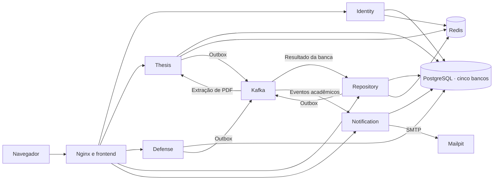

# Sistema Distribuído de Gerenciamento de Monografias

Projeto acadêmico de Sistemas Distribuídos para acompanhar monografias da UFVJM, da submissão à consulta pública. A aplicação reúne fluxos para estudantes, orientadores, coordenação e administração.

## Arquitetura e tecnologias

Cinco microsserviços Python 3.14 usam Django, Django REST Framework e Gunicorn. O PostgreSQL 18 hospeda bancos separados. O Redis 7.4 oferece locks, cotas e cache. O Apache Kafka 4.4 transporta eventos publicados via Transactional Outbox. O frontend usa HTML, CSS e JavaScript, com Nginx servindo arquivos e encaminhando as APIs na mesma origem. O Docker Compose organiza o ambiente local e o Mailpit recebe os e-mails de demonstração.

| Serviço | Responsabilidade |
| --- | --- |
| [Identity](services/identity-service/README.md) | Login, JWT RS256, perfis, papéis e administração de contas. |
| [Thesis](services/thesis-service/README.md) | Rascunhos, PDF e SHA-256, submissão, decisão do orientador, auditoria e extração assíncrona de texto. |
| [Defense](services/defense-service/README.md) | Propostas de banca, convites, agendamento, avaliações e resultado. |
| [Repository](services/repository-service/README.md) | Publicação condicionada à aprovação e à entrega dos documentos, com busca pública e download do PDF final. |
| [Notification](services/notification-service/README.md) | Consumo de eventos, resolução de destinatários, envio SMTP e consulta autenticada do histórico. |
| [Frontend](frontend/README.md) | Interface UFVJM por perfil e catálogo público. |



## Estrutura

| Diretório | Conteúdo |
| --- | --- |
| `services/` | Aplicações, migrations, dependências e testes de cada serviço. |
| `frontend/` | Páginas, estilos, JavaScript, recursos visuais e configuração do Nginx. |
| `infrastructure/` | Compose e overlays, inicialização PostgreSQL e scripts de demonstração. |
| `docs/` | Guia de instalação e roteiro ponta a ponta. |

## Execução local

Use Git, Python 3.14, Docker Desktop em modo Linux ou Docker Engine com Compose v2 e um navegador. No Windows, a partir da raiz do clone:

```powershell
py -3.14 -m venv .venv
.\.venv\Scripts\python.exe -m pip install cryptography==50.0.2
$dev = Join-Path $env:USERPROFILE '.thesis-management'
New-Item -ItemType Directory -Force $dev | Out-Null
icacls $dev /inheritance:r /grant:r "${env:USERNAME}:(OI)(CI)F"
.\.venv\Scripts\python.exe infrastructure/setup_dev.py
function dc { docker compose --env-file .env -f infrastructure/compose.yaml -f infrastructure/compose.jwt-file.yaml -f infrastructure/compose.identity.yaml -f infrastructure/compose.identity-key.yaml -f infrastructure/compose.defense.yaml -f infrastructure/compose.repository.yaml -f infrastructure/compose.notification.yaml -f infrastructure/compose.frontend.yaml @args }
dc config --quiet
dc build
dc up -d --wait
.\.venv\Scripts\python.exe infrastructure/e2e/provision_dev_users.py
```

O script cria o `.env` a partir de [`.env.example`](.env.example) e usa o diretório privado do usuário para o par RSA. Em instalações existentes, reutilize as credenciais e os caminhos já configurados. O [guia completo](docs/GUIA_EXECUCAO.md) explica permissões, Linux, variações com arquivos locais, migrations e o roteiro de demonstração.

| Componente | Acesso local padrão |
| --- | --- |
| Frontend | `http://127.0.0.1:8080/` |
| Identity | `http://127.0.0.1:8002/api/auth/me/` |
| Thesis | `http://127.0.0.1:8001/api/theses/` |
| Defense | `http://127.0.0.1:8003/api/defenses/` |
| Repository | `http://127.0.0.1:8004/api/repository/` |
| Notification | `http://127.0.0.1:8005/api/notifications/` |
| Mailpit | `http://127.0.0.1:8025/` |
| PostgreSQL, Redis e Kafka | Portas locais `5434`, `6379` e `9092`, respectivamente. |

## Testes e encerramento

Em cada serviço, execute `python manage.py check`, `python manage.py makemigrations --check --dry-run` e `python manage.py test --keepdb` com suas dependências e um banco de teste. Aponte `REDIS_TEST_URL` para o banco Redis de testes. O [guia](docs/GUIA_EXECUCAO.md#6-executar-testes) detalha as permissões e o smoke de integração existente.

Na mesma sessão PowerShell, use `dc stop` para parar a aplicação preservando bancos, PDFs, mensagens do Mailpit e offsets Kafka. Use `dc up -d --wait` para retomá-la.
